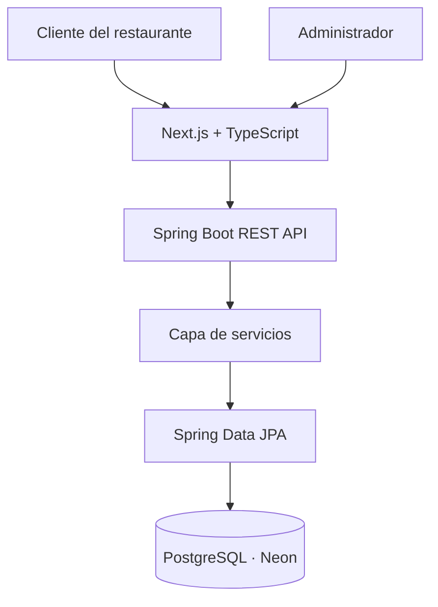

# 🍽️ Restaurant SaaS

### Digital menus made simple.

Plataforma SaaS para la creación y gestión de cartas digitales de restaurantes. Permite organizar categorías y platos, controlar su disponibilidad y ofrecer a los clientes una carta accesible desde cualquier dispositivo mediante una URL pública o un código QR.

El proyecto está desarrollado con **Java, Spring Boot, Next.js y PostgreSQL**, con una arquitectura orientada a servicios y preparada para dar soporte a múltiples restaurantes.

---

## 📌 Sobre el proyecto

Restaurant SaaS nace con el objetivo de simplificar la gestión de las cartas de restaurantes.

Los negocios de hostelería necesitan actualizar con frecuencia sus platos, precios y disponibilidad. Una carta digital permite realizar estos cambios sin tener que reimprimir cartas físicas cada vez que un producto deja de estar disponible o cambia su precio.

La plataforma está planteada como un servicio multi-tenant: varios restaurantes compartirán la misma infraestructura, manteniendo separados sus datos y sus operaciones.

**Objetivos principales:**

- Facilitar la gestión de cartas digitales.
- Permitir cambios rápidos en categorías y platos.
- Ofrecer una experiencia de consulta sencilla desde móviles.
- Construir una arquitectura mantenible y escalable.
- Desarrollar un proyecto real que aplique buenas prácticas de ingeniería de software.

## ✨ Funcionalidades

### Implementadas

- [x] Registro de restaurantes mediante la API REST.
- [x] Consulta pública de restaurantes mediante un slug único.
- [x] Creación de categorías asociadas a un restaurante.
- [x] Consulta pública de categorías activas.
- [x] Validación de los datos de entrada.
- [x] Persistencia en PostgreSQL mediante Spring Data JPA.
- [x] Gestión del esquema de base de datos mediante Flyway.
- [x] Monitorización básica mediante Spring Boot Actuator.

### En desarrollo

- [ ] Gestión completa de platos: creación, edición y eliminación lógica.
- [ ] Gestión de precios, descripciones e imágenes.
- [ ] Control de disponibilidad de platos.
- [ ] Panel de administración web.
- [ ] Visualización completa de la carta pública.
- [ ] Generación de códigos QR.
- [ ] Autenticación y autorización.
- [ ] Aislamiento de datos y permisos multi-tenant.
- [ ] Pruebas automatizadas.
- [ ] Despliegue de la aplicación.

> La lista de funcionalidades refleja el estado actual del desarrollo y se actualizará a medida que avance el proyecto.

## 🛠️ Tecnologías

| Tecnología | Uso |
|---|---|
| Java 21 | Lenguaje del backend |
| Spring Boot | Aplicación y API REST |
| Spring Data JPA | Persistencia y acceso a datos |
| Maven | Gestión de dependencias y construcción |
| PostgreSQL | Base de datos relacional |
| Neon | PostgreSQL gestionado en la nube |
| Flyway | Migraciones de base de datos |
| Jakarta Validation | Validación de peticiones |
| Lombok | Reducción de código repetitivo |
| Spring Boot Actuator | Monitorización básica |
| Next.js | Framework del frontend |
| TypeScript | Desarrollo tipado del frontend |
| Tailwind CSS | Estilos e interfaz web |

## 🏗️ Arquitectura

El proyecto separa el frontend del backend para mantener la interfaz de usuario independiente de la lógica de negocio y de la persistencia.



### Estructura del backend

```text
backend/
└── src/main/
    ├── java/com/restaurantsaas/backend/
    │   ├── controller/
    │   ├── dto/
    │   │   ├── request/
    │   │   └── response/
    │   ├── entity/
    │   ├── repository/
    │   ├── service/
    │   │   └── impl/
    │   └── BackendApplication.java
    └── resources/
        ├── db/migration/
        └── application.properties
```

La estructura separa responsabilidades:

- **Controller:** recibe las peticiones HTTP y devuelve las respuestas.
- **DTO:** define los datos de entrada y salida de la API.
- **Service:** contiene los contratos de la lógica de negocio.
- **Service implementation:** implementa las operaciones de negocio.
- **Repository:** proporciona el acceso a la base de datos.
- **Entity:** representa las tablas mediante JPA.
- **Flyway:** versiona los cambios del esquema de base de datos.

## 🔌 API REST

Los endpoints implementados actualmente son:

| Método | Endpoint | Descripción |
|---|---|---|
| `GET` | `/api/public/restaurants/{slug}` | Consultar un restaurante |
| `POST` | `/api/public/restaurants` | Crear un restaurante |
| `POST` | `/api/admin/restaurants/{restaurantId}/categories` | Crear una categoría |
| `GET` | `/api/public/restaurants/{slug}/categories` | Consultar las categorías activas |

Las operaciones de creación están implementadas para desarrollo y pruebas. Antes de publicar la aplicación en producción será necesario protegerlas mediante autenticación y autorización.

## 🗄️ Base de datos

La aplicación utiliza PostgreSQL gestionado mediante Neon.

El esquema inicial se crea con Flyway y contiene las siguientes tablas:

- `restaurants`: restaurantes registrados.
- `users`: usuarios asociados a restaurantes.
- `categories`: categorías de las cartas.
- `dishes`: platos y su información.

Se utilizan UUID como identificadores y `NUMERIC(10,2)` para los precios.

Las migraciones están en `backend/src/main/resources/db/migration/`. Una migración que ya se haya aplicado no debe modificarse; los cambios posteriores se incorporarán mediante nuevas versiones.

## 🚀 Puesta en marcha

### Requisitos

- Java 21.
- Maven, o el wrapper Maven si está incluido en el repositorio.
- Node.js y npm.
- Una base de datos PostgreSQL accesible.

### 1. Clonar el repositorio

```bash
git clone <URL_DEL_REPOSITORIO>
cd restaurant-saas
```

### 2. Configurar el backend

Configura las siguientes variables de entorno en la configuración de ejecución de Eclipse o en tu entorno local:

```text
DB_URL=jdbc:postgresql://<HOST>/<DATABASE>?sslmode=require
DB_USERNAME=<USUARIO>
DB_PASSWORD=<CONTRASEÑA>
```

Sustituye los valores de ejemplo por los de tu propia base de datos. No guardes credenciales reales en el repositorio.

### 3. Ejecutar el backend

Abre el proyecto `backend` en Eclipse y ejecuta la clase principal `BackendApplication`.

La API estará disponible, por defecto, en:

```text
http://localhost:8080
```

Para comprobar el estado de la aplicación:

```text
http://localhost:8080/actuator/health
```

### 4. Ejecutar el frontend

Cuando el frontend esté preparado, entra en su directorio:

```bash
cd frontend
npm install
npm run dev
```

Por defecto, Next.js utiliza:

```text
http://localhost:3000
```

> La configuración completa del frontend y su integración con la API forman parte de las siguientes fases de desarrollo.

## 🔐 Seguridad

La aplicación está diseñada para funcionar con múltiples restaurantes.

Antes de producción será necesario implementar y verificar:

- Autenticación de usuarios.
- Autorización para operaciones administrativas.
- Comprobaciones de pertenencia al restaurante en todas las operaciones protegidas.
- Validación de las relaciones entre platos, categorías y restaurantes.
- Gestión segura de secretos y credenciales.
- Configuración de los endpoints de monitorización para evitar la exposición de información sensible.

El `restaurantId` enviado por el cliente no debe considerarse prueba de autorización.

## 🗺️ Roadmap

- [x] Configuración inicial del proyecto.
- [x] Conexión con PostgreSQL en Neon.
- [x] Migración inicial con Flyway.
- [x] API básica de restaurantes.
- [x] API de categorías.
- [ ] API completa de platos.
- [ ] Pruebas automatizadas.
- [ ] Autenticación y autorización.
- [ ] Panel de administración.
- [ ] Carta pública completa.
- [ ] Generación de códigos QR.
- [ ] Despliegue y documentación de producción.

## 📚 Documentación

La documentación técnica del proyecto se encuentra en `docs/`:

- [`docs/architecture.md`](docs/architecture.md): arquitectura y estado del desarrollo.
- [`docs/database.md`](docs/database.md): esquema de base de datos y migraciones.
- [`docs/decisions.md`](docs/decisions.md): registro de decisiones técnicas.

## 🎯 Objetivo técnico

Además de construir un producto útil para restaurantes, este proyecto permite trabajar con:

- Diseño de API REST.
- Arquitectura por capas.
- Programación orientada a objetos.
- Persistencia relacional con JPA.
- Validación de datos.
- Migraciones de base de datos.
- Diseño multi-tenant.
- Separación de responsabilidades.
- Desarrollo full-stack.

## 📄 Licencia

La licencia del proyecto está pendiente de definir.
